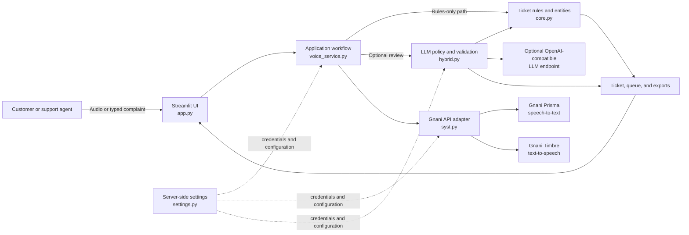

# VoiceDesk

### Multilingual complaint intake and triage for customer-support teams

VoiceDesk converts a spoken or typed complaint into a structured support ticket. It uses Gnani speech models to transcribe complaints and speak acknowledgements, then applies ticket rules to help support agents identify and prioritize cases.

> **Status:** working prototype. Live speech accuracy, live LLM accuracy, and business impact have not been measured. This project is not production-ready.

## 1. Problem statement

Enterprise support teams handle large volumes of customer contacts across languages, regions, and channels. In multilingual support, an agent may have to listen to a voice complaint, transcribe it, identify the issue and urgency, capture order or payment details, and create a ticket manually.

This intake process can:

- Consume agent time on repetitive transcription and data entry.
- Produce inconsistent categories and urgency decisions across agents.
- Make fraud and safety complaints harder to distinguish from routine requests.
- Create additional barriers for customers who prefer speaking over typing.

VoiceDesk explores a voice-first intake and triage workflow for this problem. Its goal is to reduce manual handling and improve visibility of recognized high-risk complaints. These are intended benefits, not measured outcomes; no enterprise deployment or customer study has been conducted.

## 2. Proposed solution

1. Capture a complaint as an audio recording or typed text.
2. Use **Gnani Prisma v3.0** for automatic speech-to-text and language detection; language-specific transcription uses the provider's Prisma v2.5 default.
3. Extract available details and classify the issue with deterministic rules.
4. Ask for a missing delivery order ID when appropriate.
5. Flag recognized fraud and safety complaints as Critical for human review.
6. Show a prioritized queue, suggested next step, example response target, and CSV/JSON export.
7. Use **Gnani Timbre v3.0**, with v2.5 fallback, to speak a confirmation when configured.
8. Optionally use an OpenAI-compatible LLM to review cases the rules are unsure about.

Rules own extracted entities such as order IDs and amounts. The optional LLM may refine an uncertain category or add an escalation, but cannot supply entities or downgrade a rule-based Critical ticket. If the LLM is unavailable, the rules-only path remains available.

**Gemini is an optional third-party LLM choice, not a requirement for VoiceDesk's core workflow and not a Gnani model.** The app also supports a compatible Gnani Evon endpoint, but neither Gemini nor Evon has been live-evaluated in this project. The Gnani integrations implemented here are Prisma and Timbre.

## 3. Architecture



### Component responsibilities

| Component | Responsibility |
|---|---|
| `app.py` | Streamlit UI, session state, and follow-up dialogue |
| `voice_service.py` | Connects the UI workflow to ticket, speech, and LLM operations |
| `core.py` | Deterministic ticket rules, entities, follow-up helpers, exports, and text evaluation |
| `hybrid.py` | Optional LLM call, response validation, and constrained merge with rules |
| `syst.py` | Gnani Prisma and Timbre API adapter |
| `settings.py` | Loads local `.env` or server-side Streamlit Secrets |

The browser communicates with the Streamlit app; provider requests and credentials stay server-side. Tickets are held in Streamlit session state and are not saved to a durable database.

## 4. Technology stack

| Area | Technology |
|---|---|
| Language | Python |
| User interface | Streamlit |
| Ticket rules and evaluation data | Python, pandas, CSV |
| HTTP integrations | `requests` |
| Local configuration | `python-dotenv`; Streamlit Secrets on Community Cloud |
| Speech recognition | Gnani Prisma v3.0; provider default Prisma v2.5 for language-specific transcription |
| Speech synthesis | Gnani Timbre v3.0 by default, with v2.5 fallback |
| Optional language-model review | OpenAI-compatible endpoint; Gemini is an optional external provider, or use a compatible Gnani Evon endpoint |
| Automated tests | pytest |

## 5. Results and evaluation

### Rules-only text classification

| Dataset | Examples | Category accuracy | Urgency accuracy | Both correct |
|---|---:|---:|---:|---:|
| Development set (used while tuning rules) | 31 | 100% | 100% | 100% |
| Holdout set (written afterwards) | 18 | 100% | 100% | 100% |
| Blind stress set | 43 | 70% | 70% | 63% |

The blind stress set also showed that rules recognized only **3 of 10** fraud/safety complaints with unfamiliar wording, and produced some figurative-language false escalations. This is a material limitation of rules-only triage.

The development set includes one code-mixed Gujarati and one code-mixed Tamil example with English triage keywords; these do not demonstrate full Gujarati or Tamil classification support.

### Validation status

- **Automated tests:** 54 passed in the latest run; LLM policy and fallback tests use a fake model.
- **Live LLM accuracy:** not measured.
- **Recorded speech accuracy:** not measured; no recordings have been evaluated.
- **Operational impact:** time saved, routing improvement, and customer outcomes have not been measured.
- **Production reliability:** load, availability, and recovery testing have not been performed.

All text datasets are small and developer-written. Results are development checks, not independent benchmarks or evidence of enterprise performance.

### Reproduce the text results

```powershell
python -m pip install -r requirements-dev.txt
python -m pytest -q
python core.py --eval test_complaints.csv
python core.py --eval holdout_complaints.csv
python core.py --eval blind_complaints.csv
```

The evaluation command exits with status `1` when accuracy is below its 90% gate. That is expected for the blind stress set at its current 63% category-and-urgency score.

### Evaluate recorded speech

[audio_script.csv](audio_script.csv) lists 25 prompts and expected labels across English, Hindi, Hinglish, and Kannada. Record each prompt at the WAV path listed in the CSV under `clips/`, then run:

```powershell
python eval_audio.py audio_script.csv
```

Add `--hybrid` to include the configured LLM. Results are written to `results/`. The `clips/` folder contains no recordings by default.

## 6. Quick start

Requires Python. A Gnani API key is needed for speech recognition and spoken replies; typed complaints can be tested without one.

```powershell
python -m pip install -r requirements.txt
Copy-Item .env.example .env
```

Add your real `GNANI_API_KEY` to `.env`, then run:

```powershell
python validate_api.py
python -m streamlit run app.py
```

Open the local URL printed by Streamlit and try the **Type / sample** or audio tabs. `validate_api.py` checks that configuration is present and well-formed; it does not contact a provider or confirm that credentials work.

## 7. Configuration

| Variable | Required | Purpose |
|---|---|---|
| `GNANI_API_KEY` | For speech features | Gnani API credential |
| `LLM_BASE_URL` | Optional; set with `LLM_MODEL` | OpenAI-compatible LLM endpoint |
| `LLM_API_KEY` | Optional | Credential for the configured LLM endpoint |
| `LLM_MODEL` | Optional; set with `LLM_BASE_URL` | Model identifier |
| `LLM_TIMEOUT` | Optional | LLM request timeout |
| `LLM_DISABLE_THINKING` | Optional | Controls the optional model-specific thinking parameter |
| `TIMBRE_MODEL` | Optional | Force a supported Timbre model instead of automatic fallback |

For a self-hosted Gnani Evon endpoint, an example configuration is:

```text
LLM_BASE_URL=http://localhost:8000/v1
LLM_API_KEY=none
LLM_MODEL=gnani-evon-v3.3
```

For Streamlit Community Cloud, add credentials in **App settings → Secrets**. Never commit `.env`, `.streamlit/secrets.toml`, API keys, or recordings containing personal data.

## 8. Security, privacy, and production readiness

- Phone and card numbers are masked in transcript text. This is limited masking, not a complete privacy or compliance control.
- If an external LLM such as Gemini is configured, the complaint text (up to 1,500 characters) is sent to that provider for review. Do not use real or sensitive customer data without an approved privacy and data-processing review.
- The project has no durable ticket database, enterprise authentication, role-based access, monitoring, CRM integration, or production incident process.
- SLA values shown in the app are examples, not operational commitments.
- A public demo link can consume provider quota. Apply usage limits and share it deliberately.
- Provider URLs appear in source code and are not secrets; API keys must remain in server-side configuration.

Before use in a real support operation, the system would need evaluation on representative recordings and independently collected complaints; live provider testing; durable storage and access controls; privacy/security review; CRM integration; and operational monitoring and incident ownership.

## 9. Project files

| File | Description |
|---|---|
| `README.md` | Problem, solution, architecture, stack, metrics, and setup |
| `PRODUCT_OVERVIEW.md` | Product use case and prototype status |
| `RUN_ME_FIRST.txt` | Short Windows local setup instructions |
| `test_complaints.csv` | Development text evaluation set |
| `holdout_complaints.csv` | Developer-written holdout text set |
| `blind_complaints.csv` | Developer-written stress set |
| `audio_script.csv` | Speech evaluation prompts and expected labels |
